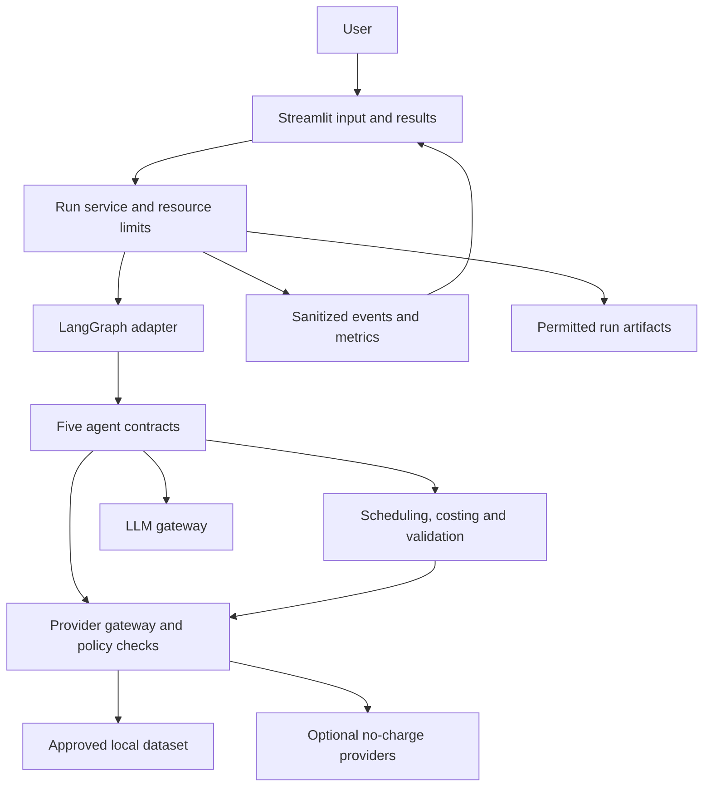
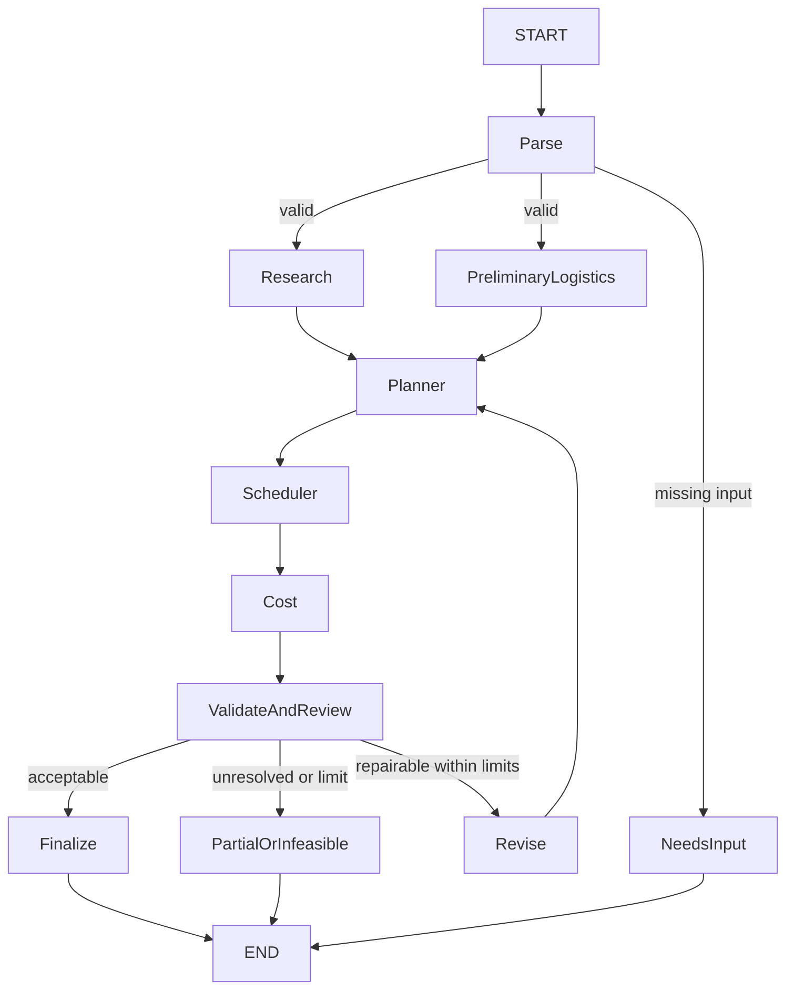

# Dubai AI Travel Planner: Architecture

**Provider scope:** Use the approved local catalog, licensed open datasets, and separately reviewed no-charge sources only. External capabilities remain disabled until their access, quota, coverage, and reuse checks pass.

**Status:** Target architecture with Phases 0–4 implemented, including fixture-based graph execution. Model-driven agents and the full graph UI remain later phases. See [implementation plan](implementation%20Plan.md) and [setup guide](../README.md). **Reviewed:** 4 November 2026. **Requirements:** [problemstatement.md](problemstatement.md). **Data research:** [research.md](research.md).

**Implementation status synchronized:** 15 November 2026. Phases 0–4 are complete,
with Phase 2 acceptance scoped to the four-day offline example and its disclosed
estimates. Dataset `2026-11-15.2` and the historical 71-test verification are
documented in the [plan's current delivery snapshot](implementation%20Plan.md).
The [Phase 0–3 verification report](../evaluation/phases-0-3-verification.json)
records the subsequent full test run, catalog consistency and app checks using
the existing environment; it does not refresh external evidence.
The [agent sequence playbook](../playbok.md) distinguishes the current deterministic
call path from model-driven agent execution. Phase 4 now implements parallel
fixture branches, explicit join, bounded repairs and sanitized events. All 99 tests
pass; see [Phase 4 verification](../evaluation/phase4-verification.json).
Remaining Phase 5–7 work requires a further request.

Defaults, module paths, thresholds, and schemas below are implementation recommendations. Framework capabilities are cited separately. External travel-data integrations remain conditional on no-charge eligibility, quotas, access, coverage, licensing, and configuration.

## 1. Scope and decisions

Build a single Python/Streamlit application supporting 1–7 day Dubai itineraries,
seven LangGraph roles, AED expense estimates, deterministic validation, and bounded
revisions. The Planner and Scheduler extend the original five-role minimum with explicit
selection and scheduling ownership. Recommend accommodation areas and options; booking,
payment, guaranteed availability, and destinations outside Dubai remain out of scope.

Agents interpret preferences, select recommendations, explain tradeoffs, and propose repairs. Python services own arithmetic, temporal checks, evidence requirements, resource limits, and final status. An LLM review cannot override a failed rule.

**Framework decision — 15 November 2026:** LangGraph is the sole multi-agent
orchestration framework. Implement the seven specialist roles as graph nodes;
shared state, parallel branches, joins, conditional routing and bounded revisions
belong to that graph. No alternative agent-framework dependency, adapter or
framework-comparison implementation is in scope. Model clients and deterministic
Python services support the graph without introducing another orchestration layer.
The Phase 4 fixture graph is implemented; model-driven agents remain Phase 5.

| Decision | Proposed choice | Reason |
| --- | --- | --- |
| Deployment | One application process | Educational MVP does not require a separate API server or microservices. |
| Domain | Pydantic models and shared Python services | Consistent contracts across graph nodes and data tools. |
| Orchestration | LangGraph only | One stateful graph for dependencies, parallel research, joins, conditional routing and bounded revisions. |
| Storage | Approved curated JSON; SQLite for permitted metadata | Reproducibility and simple operations. |
| Discovery | Structured filtering and geographic clustering | Small catalog does not require a vector database. |
| Model | Configurable model/provider | Record configuration for reproducible evaluation. |
| Validation | Deterministic rules plus qualitative review | Separate measurable feasibility from preferences. |
| Revisions | Maximum two after initial plan | At most three complete reviews. |

## 2. Components



The UI calls the run service, not providers directly. The LangGraph runner implements `run(request, context, emit_event) -> PlanResult`. Every run has an immutable request snapshot, unique ID, model/configuration hash, prompt version, and dataset version. Cancellation and deadline checks occur before tasks, tools, and revisions.

External text and model outputs are untrusted. Provider normalization and domain validation stand between them and the displayed plan. Model-generated factual claims must resolve to supplied evidence or be labeled assumptions.

## 3. Proposed module structure

```text
app.py
src/dubai_planner/
  config.py
  domain/
    requests.py
    places.py
    itinerary.py
    money.py
    review.py
    events.py
  agents/
    contracts.py
    orchestrator.py
    destination.py
    logistics.py
    budget.py
    reviewer.py
    prompts/
  orchestration/
    interface.py
    langgraph_runner.py
    revision_policy.py
  services/
    run_service.py
    scheduling.py
    costing.py
    validation.py
    candidate_selection.py
    evidence.py
  providers/
    interfaces.py
    gateway.py
    policy.py
    local.py
    osm.py
    open_routing.py
    official_data.py
    weather.py
  storage/
    repository.py
    migrations/
  ui/
    input_form.py
    timeline.py
    itinerary_view.py
    validation_view.py
  observability/
    event_sink.py
    metrics.py
    redaction.py
data/curated/
config/provider_policies/
tests/{unit,contracts,integration,scenarios,fixtures}/
evaluation/{requests.jsonl,rubric.md}
docs/{problemstatement.md,architecture.md,research.md}
.env.example
pyproject.toml
```

These are implementation targets. Optional integrations must not require all vendor credentials or SDKs merely to launch the application.

## 4. Inputs and assumptions

Collect natural-language input plus optional structured dates/times, trip days, traveler count and age bands, rooms, nights, budget scope, interests, mobility needs, transport preferences, and exclusions.

A `Constraint` has `id`, `field`, `operator`, `value`, `priority` (`hard` or `soft`), and `origin` (`user`, `default`, `derived`). Preserve explicit exclusions. Default suggestions are Dubai, AED, one adult, one room, and flights excluded; display them before execution. Clearly label whether a budget is total-trip or per-person. Ambiguous budget scope, conflicting dates/duration, and missing critical hard-constraint inputs produce `needs_input` rather than silent assumptions.

Hotel nights are independent of itinerary days. Derive nights from confirmed check-in/check-out dates or obtain them explicitly. A suggested `days - 1` value remains an assumption requiring confirmation. Undated travel uses relative Day 1–Day N slots and cannot claim date-specific prices, opening hours, availability, forecasts, or transit service.

## 5. Shared schemas

Use versioned Pydantic contracts and validate at provider, agent, storage, and UI boundaries. Pydantic provides models and `model_validate`; application rules must still establish factual and cross-record consistency. Restrict coercion for critical counts and monetary fields. [Pydantic models](https://docs.pydantic.dev/latest/concepts/models/)

| Model | Main fields and invariants |
| --- | --- |
| `TripRequest` | ID, destination, 1–7 days, optional dates, timezone, travelers, rooms/nights, budget/scope, constraints, assumptions; departure after arrival. |
| `Evidence` | ID, provider, URL/local record ID, retrieval time, source update time if known, applicable dates, dataset version, quality, attribution, retention-policy ID. |
| `PlaceCandidate` | Internal ID, provider IDs, name, category, area, coordinates, interests, visit-duration range, accessibility/hours/price evidence, suitability summary. |
| `AccommodationOption` | Area/property, occupancy, rooms/nights, quote dates, price basis, taxes/fees inclusion, availability status, evidence. |
| `RouteLeg` | Origin/destination IDs, mode, departure, distance, duration range, cost basis, evidence, method, validity window. |
| `ActivitySlot` | ID, place ID, day/date, start/end, participants, booking requirement, hours-check status, evidence IDs. |
| `DayPlan` | Ordered visits, connecting route legs, meals/rest, base assumption, daily time limits. |
| `CostLine` | Category, entity reference, unit price/range, currency, billing unit, quantity, inclusions, tax/fees, known/estimated/unknown status, evidence. |
| `BudgetSummary` | Known subtotal, estimated bounds, missing required costs, contingency, totals where calculable, cap, compliance, exclusions. |
| `ReviewFinding` | Rule ID, severity, affected entities, evidence, owner, proposed action, hard/soft classification. |
| `RevisionRequest` | Revision number, findings, allowed edits, immutable constraints, invalidated artifacts. |
| `PlanResult` | Run ID/graph version, request, days, accommodation, budget, findings, status, assumptions, sources, freshness warnings, revisions, metrics. |

Use `Decimal` internally and decimal strings in JSON for money. Audit timestamps use UTC; travel schedules use timezone-aware `Asia/Dubai`, regardless of the operator's computer timezone. Undated relative slots use a separate representation.

Distinguish `known`, `estimated`, `stale`, `unavailable`, and `conflicting` evidence. Missing prices are null with reasons, never zero. Missing hours do not imply all-day opening. Unknown source update dates stay null.

## 6. Agent contracts

| Agent | Inputs | Outputs | Responsibility |
| --- | --- | --- | --- |
| Orchestrator | User request/configuration; later findings | Request, selection, revision requests, assembled result | Interpret constraints, coordinate dependencies, preserve hard limits. |
| Destination Research | Request and approved discovery tools | Ranked candidates and alternatives | Attractions, food, culture, neighborhoods, interest alignment. |
| Logistics | Request/area data, then selected candidates | Accommodation areas/options, routes, timed days | Geographic sequencing, transport, hours, travel/rest allowances. |
| Budget | Scheduled visits, routes, stays, price evidence | Calculated summary and alternatives | Resolve units/quantities; invoke costing service; explain options. |
| Review | Complete plan, evidence, deterministic findings | Additional findings and recommendation | Grounded preference assessment and repair suggestions. |

Budget outputs cannot replace calculated totals with generated arithmetic. Review cannot decide final success independently. Orchestration cannot relax a hard budget, mobility need, or exclusion without changed user input.

Destination research and preliminary logistics may run concurrently: preliminary logistics explores areas and regional transport assumptions. Final routes and sequencing require selected candidate locations and must wait for them. Agents pass stable IDs and compact validated objects, not unrestricted copies of raw provider responses.

## 7. LangGraph execution

LangGraph models workflows using state, nodes, and edges, with reducers and conditional routing. Proposed state gives scalar outputs one writer and uses keyed merge reducers for shared append-only records. [LangGraph Graph API](https://docs.langchain.com/oss/python/langgraph/graph-api)



After parsing, a conditional router starts destination research and preliminary logistics
for valid inputs, or finishes with `needs_input`. Wire the barrier with
`add_edge(["destination", "preliminary"], "planner")`. The Planner waits for both
outputs, and the Scheduler then builds the deterministic schedule. Multiple start nodes
make the successor wait for all listed nodes; do not substitute two independent incoming
edges for this explicit barrier. [LangGraph add_edge](https://reference.langchain.com/python/langgraph/graph/state/StateGraph/add_edge)

| State fields | Ownership |
| --- | --- |
| Request, run ID, configuration | Initialized once |
| Candidates | Research |
| Preliminary logistics | Preliminary logistics |
| Selection | Planner, then revision controller |
| Days and routes | Scheduler |
| Accommodation/base | Preliminary logistics |
| Budget | Costing |
| Findings, status | Validation/review |
| Revision counter | Revision controller |
| Events/evidence references/metrics keyed by ID | Merge reducers |

Merge immutable records by stable IDs; reject different values for the same ID. Deduplicate retried events and sort presentation by sequence/timestamps. Concurrent nodes never write the same scalar. Return partial updates rather than mutating shared state in place.

Review routes to exactly one of `finalize`, `revise`, or `unresolved`; attach no
unconditional outgoing edge as well. Revision increments the counter, dispatches findings
to relevant specialists, and changes selection or logistics constraints. Always rerun
Planner, Scheduler, budget, and review afterward. The MVP deliberately prefers full
downstream recomputation to complicated partial invalidation.

With `max_revisions=2`, initial plan 0 and revisions 1–2 each receive a complete review. A proposed recursion limit of 50 super-steps is a separate defensive guard, to be tested with the pinned graph. Stop on unchanged plan/findings, resource exhaustion, unavailable critical data, or irreconcilable user constraints. No revision bypasses validation.

## 8. Data acquisition policy and graph tool boundaries

Travel-data acquisition uses curated local records, licensed open datasets, and optional eligible no-charge services. Paid travel-data APIs, subscription integrations, and billable overage paths are not part of the design. Free quotas are hard ceilings: stop requests and fall back locally when a ceiling is reached. Never upgrade automatically.

**Provider boundary confirmed: 15 November 2026.** Future phases must not introduce
paid travel-data adapters, associated SDKs or credentials, billing setup, or
chargeable fallback calls. Trial credits and billing-enabled free tiers do not
satisfy the no-charge requirement. Select only the eligible options below and
the licensed sources in [research](research.md); otherwise use the local catalog
or return an explicit evidence gap. This documentation change enables no external
service. The Phase 4 fixture graph also uses only local approved data.

| Capability | Default | Optional no-charge enhancement |
| --- | --- | --- |
| Places and restaurants | Reviewed local catalog with coordinates | Bounded OpenStreetMap / Overpass imports |
| Travel duration | Reviewed area-to-area ranges | Local OSRM/openrouteservice engine or an eligible free endpoint with verified quotas and Dubai coverage |
| Transit | Official RTA fare references and explicit schedule assumptions | Licensed, no-charge GTFS only after access and service dates are verified |
| Accommodation | Curated area recommendations and dated price ranges | Manually reviewed permitted operator information; no live hotel inventory API |
| Weather | Omit when unavailable | Eligible Open-Meteo free forecast service |

All graph nodes use the same gateway. The gateway enforces source eligibility, rate limits, schema validation, provenance, and fallback policy. A parallel branch cannot bypass a shared quota. Research produces candidates; logistics consumes selected locations; costing consumes the resulting schedule; review checks all resulting evidence.

The no-charge requirement concerns travel-data calls. Model inference and hosting have separate budgets; local inference is an option when required. Running an open-source routing engine locally avoids per-call provider fees but still needs hardware, map updates, and maintenance. Public demo servers are not assumed to be production backends.

## 9. Geography and schedules

1. Filter hard exclusions, destination scope, and required accessibility evidence.
2. Select candidates (proposed maximum 20) and cluster nearby locations.
3. Establish a base/accommodation assumption. An area centroid is approximate, not a known hotel entrance.
4. Sequence visits within applicable hours, accounting for travel, meals, rest, queues, and visit duration.
5. Query selected route legs rather than all catalog pairs; include departure time when supported.
6. Verify each consecutive visit has a connecting leg and enough time. Recalculate after changing a place.

Proposed configurable heuristics are a 15-minute activity buffer and 20% travel contingency, clearly labeled and not double-counted when the source already includes allowances. They are not observed Dubai queue or traffic data.

Straight-line distance can support a documented approximate fallback, but cannot establish roads, transit service, accessibility, or guaranteed duration. Missing critical route evidence leaves feasibility unknown. A road-routing profile does not establish transit schedules or fares. Enable only modes actually supported by the selected engine and dataset; retain explicit uncertainty for curated transport estimates. An identified RTA/GTFS dataset is not a usable integration until retrieval, license, freshness, and coverage are verified.

Crowd avoidance uses labeled heuristics or actual evidence, never invented live counts. Optional weather recommendations use supported forecast dates; seasonal guidance remains distinct from forecasts.

## 10. Deterministic costing

Compute each extended cost as `unit_price × quantity` using Decimal. Calculate low/high estimates separately. Normalize each quote's price basis before costing so nights, rooms, and travelers are multiplied only when the quoted unit requires them. Quantities follow the source's billing unit:

| Expense | Quantity |
| --- | --- |
| Hotel | Per-room/night quote: rooms × nights; per-room/stay quote: rooms; whole-party/stay quote: one. Check occupancy and quoted stay dates; never multiply included nights or rooms again. |
| Attraction | Eligible tickets/travelers and supported age categories |
| Meals | Travelers × meals, or explicit group-bill basis |
| Taxi/car | Vehicle trips, accounting for capacity |
| Transit | Passenger journeys or applicable passes, avoiding double charging |
| Fees/taxes | Source-defined percentage or per-unit base, applied once |

Track included and excluded taxes, service charges, and compulsory property fees. Never assume one universal hotel-tax formula or add tax to an inclusive quote again. Unknown mandatory fees make the total incomplete. Respect flight exclusions and expose assumptions for shopping and other discretionary expenditure.

Convert foreign quotes only with documented rate source, timestamp, and rounding policy; otherwise they cannot support the AED total. Proposed display precision is AED 0.01 with a recorded Decimal rounding policy. Sum precise values before final display rounding.

Proposed contingency is 10% of included known/estimated expenditure, configurable and shown separately. Include it when checking the cap. Ranges are scenario bounds, not statistical confidence intervals.

Budget states:

- `within_estimate`: every required amount has usable bounds and the upper total including contingency is within the cap.
- `over_budget`: the lower total already exceeds the cap.
- `at_risk`: the range crosses the cap.
- `unknown`: missing required quantities, costs, fees, or budget scope.

Illustrative test fixture: two adults, one room, three nights at AED 300/night, two AED 100 tickets, and four shared AED 40 taxi trips total AED 1,260 before meals, fees, and contingency. Hotel quantity is three, ticket quantity two, and taxi quantity four. These are synthetic values, not current Dubai prices.

Re-route and re-cost alternatives. A cheaper distant hotel can increase transport expenditure and reduce usable time. Alternatives must preserve hard constraints unless the user explicitly changes them.

## 11. Validation and outcome states

| Check | Examples | Owner |
| --- | --- | --- |
| Structural | Missing days, invalid coordinates, negative costs, duplicate IDs | Schemas/domain code |
| Hard constraints | Duration, cap, exclusions, required accessibility | Deterministic validation |
| Temporal | Overlaps, closed venue, insufficient travel time, departure deadline | Scheduling service |
| Financial | Wrong quantities, missing fees, overlapping fares/passes | Costing service |
| Evidence | Unsupported price, stale hours, absent route provenance | Evidence service |
| Soft preferences | Interests, pace, food variety, crowd preference | Grounded reviewer and rubric |

Terminal status is `validated_estimate`, `partial`, `infeasible`, `needs_input`, `failed`, or `cancelled`. A validated estimate passes evaluated hard constraints under disclosed evidence and assumptions; it does not guarantee availability. Partial results retain useful content while listing unresolved checks. Infeasible means a demonstrated conflict within supplied constraints/candidates, not proof that no possible Dubai plan exists. Failed means execution produced no usable artifact.

Deterministic findings remain in the report until the plan or evidence changes. Unknown hours for a critical appointment, unknown accessibility for a hard need, or missing mandatory expenses prevent unqualified validation. Reviewer opinions cannot erase violations.

## 12. Provider contracts and modes

```text
search_places(query, filters, context) -> ProviderResult[list[PlaceCandidate]]
get_place_details(id, dates, context) -> ProviderResult[PlaceCandidate]
route(origin, destination, mode, departure, context) -> ProviderResult[RouteLeg]
search_accommodation(area, dates, travelers, rooms, context) -> ProviderResult[list]
get_price(entity_id, date, participants, context) -> ProviderResult[PriceEvidence]
get_weather(location, dates, context) -> ProviderResult[WeatherEvidence]
```

`ProviderResult` includes typed data, evidence, warnings, latency, quota/cost metadata, and retry classification. Distinguish `ok`, `empty`, `unsupported`, `unauthorized`, `rate_limited`, `unavailable`, and `invalid_response`. Empty search results do not mean failed API access.

| Mode | Behavior | Disclosure |
| --- | --- | --- |
| Offline-data | Approved local records only; no travel APIs | Dataset version/dates and estimation methods |
| Hybrid | Configured live capabilities with approved local fallback | Per-field source and fallback reason |
| Live-required | Required capabilities must have live evidence | Partial/failure on missing evidence; no silent fallback |

Live-required applies only to enabled no-charge capabilities, such as a supported weather forecast or route service. It does not introduce live accommodation inventory or paid providers. Local accommodation estimates remain explicitly labeled in every mode.

Offline-data mode can still call a remote LLM. Fully network-free operation requires a local model or deterministic fixture runner, presented separately.

Detailed acquisition choices and access gates belong in [research.md](research.md). Visit Dubai is a reference/link source unless reuse permission is established. A Dubai portal listing does not prove a dataset is accessible. Public Nominatim is not the default automated geocoder; select a usage pattern/provider compliant with its policy.

## 13. Provenance, storage, and retention

Separate curated knowledge, operational metadata, and provider content. Preserve field-level evidence, applicable dates, and conflicting records. Prefer authoritative operational facts, but do not silently overwrite disagreement.

Proposed SQLite tables are `runs`, `run_metrics`, `events`, `curated_entities`, `curated_evidence`, and `artifact_manifests`, with versioned migrations and a single writer queue. Store only permitted artifacts. Itineraries can themselves contain restricted provider content.

Every provider policy defines allowed fields, persistence permission, maximum retention, attribution, export permission, and review date. Missing policy means persistent caching/export is disabled until reviewed. Freshness TTLs cannot create storage rights.

Open datasets and free services still have attribution, reuse, and operating conditions. Preserve OSM source attribution and review database redistribution requirements; apply source-specific storage and export rules. [OSM attribution guidance](https://osmfoundation.org/wiki/Attribution_Guidelines)

Checkpoints, prompts, tool caches, Streamlit caches, traces, and downloads are also storage surfaces. Filter or disable them where restricted content would persist. Keep IDs/approved summaries in checkpoints and re-fetch where required. Never copy unapproved external content into the permanent fallback dataset.

Proposed default retention is session-only. Explicit saving may persist permitted sanitized content; a configurable seven-day metadata retention is suitable for demonstrations. Do not save credentials, personal free text, or full prompts by default. Expiry maintenance deletes permitted stored artifacts according to policy; aggregate non-identifying metrics are retained only where allowed.

## 14. Reliability and limits

Proposed starting values, subject to measurement:

| Limit | Value |
| --- | --- |
| Whole run | 180 seconds |
| Provider request | 10 seconds |
| LLM request | 45 seconds |
| Concurrent provider requests | 4 |
| External provider calls | 40 per run |
| LLM calls | 20 including repairs and revisions |
| Cumulative model tokens | 40,000 per run |
| Revisions | 2 |
| Transient retries | Two additional attempts within deadline |
| Output-schema repair | One per task, counted in model limits |

Check admission before calls; constrain output tokens. A configurable inference-cost ceiling uses the selected model configuration. Unknown inference cost is reported as unknown, never zero. Travel-data adapters must enforce no-charge eligibility and quota ceilings before every call. Apply account-wide concurrency/rate limits across sessions as well.

Retry only eligible transient failures with bounded exponential backoff and jitter. Honor `Retry-After` within the remaining deadline. Do not retry invalid credentials, inputs, or unsupported features. The gateway owns retry policy; disable competing framework retries to avoid multiplication.

A route failure can use approved approximate data only if the selected mode permits it. Accommodation recommendations use dated local ranges and must never imply live inventory or confirmed availability. After one failed schema repair, fail the task cleanly. Cancellation blocks new work and ignores late results by run ID. No-progress reviews stop early with disclosed unresolved findings.

## 15. Streamlit and observability

Streamlit reruns code on interactions; session state persists session values. Use a submitted form and immutable run ID to avoid duplicate execution and quota consumption. Session state is not durable job storage. [Streamlit execution model](https://docs.streamlit.io/get-started/fundamentals/main-concepts), [Session State](https://docs.streamlit.io/develop/api-reference/caching-and-state/st.session_state)

Views cover inputs/assumptions, execution timeline, days, budget, sources/limitations, and validation findings. A local worker may emit sanitized events to a queue; only the UI thread calls Streamlit. The registry owns idempotent start/cancel; polling cannot restart work. A synchronous first prototype may stream updates, with worker cancellation added later.

Events include `run_started`, `agent_started`, `provider_result`, `artifact_ready`, `validation_finding`, `revision_started`, `plan_changed`, and `run_completed`, with run/task IDs, revision, timestamp, safe summary, and artifact references. Show outputs and concise reasons such as moving a visit to fit opening hours. Do not display private chain-of-thought, hidden prompts, credentials, or raw traces.

Metrics include elapsed time, calls/tokens, retries, fallbacks, revisions, validation outcome, execution cost or unknown-cost status, cache activity, and source freshness. Downloads include assumptions/citations and obey export policies.

## 16. Security and configuration

Use environment variables or deployment secrets; commit placeholders only. Proposed names include `LLM_PROVIDER`, `LLM_MODEL`, `DATA_MODE`, `MAX_REVISIONS`, `RUN_TIMEOUT_SECONDS`, `OVERPASS_ENDPOINT`, `ROUTING_BACKEND`, `ROUTING_BASE_URL`, and `OPEN_METEO_ENABLED`. Validate configuration and expose capability flags without secret values.

Allowlist tools and provider hosts. Agents cannot execute arbitrary shell commands, SQL, or user-supplied URLs. Validate coordinates, dates, response sizes, and URLs. A future URL importer must reject private-network and metadata addresses. Retrieved instructions remain data, separated from user intent in prompts.

Minimize traveler information: age bands and necessary accessibility needs suffice; passport/payment details are unnecessary. Redact logs, review telemetry settings, isolate sessions, and restrict API keys where supported. Add authentication and account-level rate limits before a public shared deployment.

## 17. Tests and evaluation

Unit tests cover Decimal units/quantities, tax inclusion, missing prices, date boundaries, route adjacency, hours, schema validation, and revision termination. Provider contracts cover malformed payloads, timeouts, rate limits, missing credentials, and policy enforcement using synthetic or licensed fixtures.

Scenarios include the four-day AED 5,000 sample; one/seven-day plans; two adults plus child; impossible cap; undated travel; unknown accessibility; API outage with disclosed fallback; live-required failure; duplicate activities; no-progress revisions; and cancellation.

Every LangGraph execution path must satisfy the same schema, hard checks, evidence requirements, and review cap. Seed an invalid first plan and verify that a later review sees recomputed routes and costs, not stale artifacts.

For regression evaluation, use fixed requests, an approved dataset snapshot, recorded model/version/settings, prompts, limits, and validator version. Proposed repetitions are five per request; report distributions and inference nondeterminism. Measure hard-constraint success, partial/failure rate, provenance completeness, preference alignment, latency, model calls, quota use, and revision recovery.

Test parallel fan-out and join behavior, reducer conflicts, no-progress termination, and downstream recomputation after revisions. Verify that exhausted free-service quotas trigger local fallback without any billable request. Keep live freshness changes outside the baseline using permitted fixtures; evaluate optional live sources separately.

## 18. Deployment and phases

Pin and test compatible Python/package versions together. Once implemented, local entry is `streamlit run app.py`. A later single-container deployment mounts approved data read-only and permitted SQLite storage on a writable volume. Ephemeral hosted storage is not durable. Startup checks validate dataset/configuration integrity and enabled capabilities.

| Phase | Deliverable | Exit criterion |
| --- | --- | --- |
| 0 | Project foundation and configuration | Locked environment installs; local-only startup works. |
| 1 | Domain and agent contracts | Invalid inputs rejected; unknown values preserved. |
| 2 | Local catalog, provenance and policy-gated tools | Imports and reads pass policy checks; remaining evidence gaps are explicit. |
| 3 | Deterministic scheduling, costing and validation | Fixture plans produce independently tested totals and honest outcomes. |
| 4 | Fixture-driven LangGraph, join, review loop and events | Seeded violation repaired; revision cap proven. |
| 5 | Model gateway and seven specialist roles | Actual model-driven collaboration passes shared validation. |
| 6 | Inputs, timeline, budget, sources and run management UI | Rerenders do not duplicate work; cancellation and partial status visible. |
| 7 | Reliability and repeated regression evaluation | Reproducible configurations and honest failure/cost results. |
| Post-MVP | Optional no-charge sources one capability at a time | Eligibility, quota, coverage, attribution, and retention tests pass. |

Phase numbering follows the [implementation plan](implementation%20Plan.md).
Phases 0–4 code is implemented. Phase 2's bounded four-day local-data example is
complete with explicit opt-in estimates and two scoped hotel quotes; broad catalog
coverage remains limited. See [Phase 2 evidence and reproduction](phase2-example.md).
The current UI also supports reviewed JSON catalog editing/import, deterministic
trip forms, and compressed immutable itinerary snapshots in the existing SQLite
database. Source permissions are checked on persistence/read/export; catalog edits
preserve evidence review dates and reject stale concurrent saves. Saved plans can
be reopened and explicitly rechecked with current data. This authorized local UI
extension does not complete Phase 6 agent progress, run management or cancellation.

## 19. Requirements traceability

| Requirement | Design | Acceptance evidence |
| --- | --- | --- |
| Natural-language interpretation | Typed request/constraints | Extract budget, duration, exclusions correctly. |
| Personalized 1–7 day Dubai plans | Candidate selection and scheduler | One/four/seven-day scenarios. |
| Attractions, food, stays, transport | Shared entity/route contracts | Connected itinerary with accommodation assumptions. |
| AED budgets and alternatives | Decimal costing and revision | Quantity/tax tests; alternatives recomputed. |
| Five collaborating agents | Explicit output ownership/dependencies | Timeline shows downstream use of specialist output. |
| Review-driven changes | Deterministic checks and bounded loop | Invalid initial plan repaired and reviewed again. |
| LangGraph features | Fan-out, join, reducers, conditional routing | Integration trace and parallel-write tests. |
| No-charge travel data | Local catalog and gated free integrations | Quota exhaustion falls back without billable calls. |
| Local fallback | Offline-data/hybrid policies | Outage produces disclosed estimates. |
| Execution visibility | Sanitized events and change summaries | UI shows useful artifacts and revisions. |
| Honest limitations | Unknown/partial states and evidence policy | Missing critical evidence cannot silently pass. |

Open implementation decisions are the model account, approved initial dataset contents, pinned dependencies, host, and optional capabilities that pass access/license checks. These do not alter shared contracts or the requirement to validate every final plan against its disclosed evidence.

