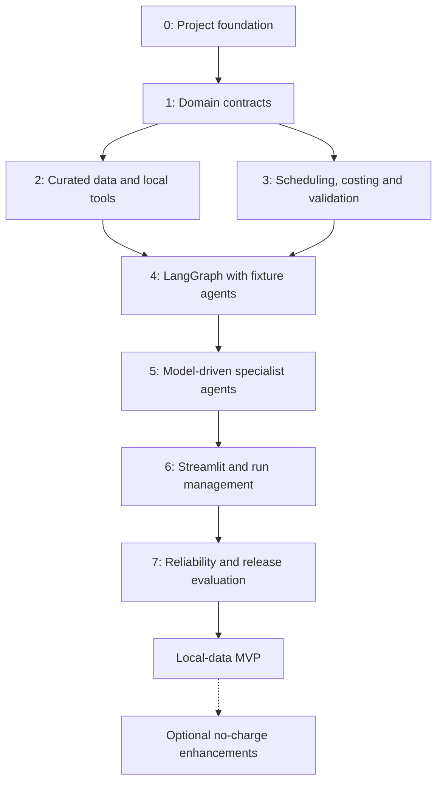

# Dubai AI Travel Planner: Implementation Plan

**Status:** Phases 0–4 implemented, including fixture-based LangGraph orchestration. Phase 2's bounded four-day local-data acceptance is complete under disclosed opt-in estimates. Broader data coverage remains future work. Phases 5–7 remain incomplete.  
**Planning date:** 5 November 2026. **Documentation synchronized:** 15 November 2026.  
**References:** [Problem statement](problemstatement.md), [Architecture](architecture.md), [Agent sequence playbook](../playbok.md), [Data research](research.md).

## Current delivery snapshot

This plan tracks completion; the [playbook](../playbok.md) explains execution
sequences; the [architecture](architecture.md) defines contracts and constraints.
Their status statements are synchronized to the work completed so far. This is
updated alongside implementation and verification evidence.

| Phase | Current state | Evidence or next deliverable |
| --- | --- | --- |
| 0 — Foundation | Complete | Project setup and configuration |
| 1 — Contracts | Complete | Typed requests, evidence, results and agent/runner interfaces |
| 2 — Local data | Complete for the bounded example | Dataset `2026-11-15.2`; four-day offline estimate and two hotel alternatives |
| 3 — Deterministic services | Complete | Selection, scheduling, costing and independent validation |
| 4 — Fixture graph | Complete | Parallel branches, explicit join, targeted repairs, fresh review artifacts, events and bounded termination; 24 graph tests |
| 5 — Model-driven agents | Implemented; live acceptance is opt-in | Groq planning specialists, Gemini review, structured gateway and provider-shaped tests |
| 6 — Planning UI | Complete | Session run registry, natural-language extraction, agent form, timeline, cancellation, result rendering, saving and downloads |
| 7 — Release evaluation | Implemented offline; live release gate pending | Versioned 12-scenario matrix, five-repeat fixture baseline and safe metrics report |

**Reverified, 15 November 2026:** 71 tests, Ruff lint/format, source-policy checks,
repeatable catalog import and dated/undated catalog-app checks passed. The active
SQLite catalog matches the curated JSON. Both hotel alternatives pass the
historical four-day scenario. See the [verification report](../evaluation/phases-0-3-verification.json).
The existing environment was reused without installing packages. The saved
[Phase 2 result](../evaluation/phase2-result.json) is a historical snapshot;
current planning still rejects stale quotes. The original undated sample remains
`partial`. Broader catalog coverage and live booking guarantees are not complete.

**Phase 4 verification:** 99 tests pass, including 24 graph tests; Ruff lint/format,
historical graph reproduction and current-clock fixture CLI checks pass. See
[Phase 4 verification](../evaluation/phase4-verification.json) and
`scripts/verify_phase4.py`. No seed changes, installations or external calls were required.

**Phases 6-7 verification, 16 November 2026:** 123 tests pass, including
session-run isolation and Streamlit rerender integration. Ruff lint/format and
headless startup pass. The versioned Phase 7 fixture baseline records 16 runs,
100% expected outcomes and 100% referenced-evidence completeness in
`evaluation/phase7-verification.json`. This is offline orchestration/reliability
evidence, not model-quality evidence. The actual seven-role release demonstration
and five repeated live model runs remain opt-in because they transmit approved
request/catalog fields and consume Groq/Gemini quota.

**Scope boundary:** Phase 4 was explicitly authorized and implemented. Do not
implement remaining Phases 5–7 work without a further request. The local data
manager and saved-trip UI subset remain available; the UI does not invoke the graph yet.

**Phase 2 completion, 15 November 2026:** Dataset `2026-11-15.2` provides two
exact three-night hotel snapshots, four reviewed recurring-hours projections,
20 road-network route estimates and explicit meal/transport/ticket-fee allowances.
The dated example and its hotel alternative pass independent deterministic checks
offline. All 71 tests and Ruff checks pass. Opt-out and stale-evidence cases remain partial. See
[reproduction and limitations](phase2-example.md).

Historical verification and earlier evidence gaps (superseded snapshots)

**Evidence update, 15 November 2026:** Dataset `2026-11-15.1` adds two verified
free-entry products, Dubai Mall retail hours and two hotel occupancy records;
it rechecks the Rove offer, Frame and mosque sources. Date-aware coverage and
price lookups reject inapplicable offers. The catalog UI now displays hotel
evidence and price source links. 59 tests pass. Phase 2's bounded three-night
accommodation quote and scenario feasibility evidence remain open; no live
quote or route guarantee was manufactured. See [data review](data-catalog.md).

**Verification, 5 November 2026:** 48 tests pass in both the existing environment
and a clean Python 3.12.16 environment installed from `uv.lock`. Ruff lint and
format checks pass. Catalog import and Streamlit catalog startup pass. See
[setup instructions](../README.md), [data review](data-catalog.md), and the
[sample result](../evaluation/sample-result.json).

**Coverage update, 5 November 2026:** 53 tests pass after public-source enrichment;
lint and formatting checks pass in the existing environment. Dataset version
`2026-11-05.3` adds museum and mosque prices, one dining option, published hours
and Rove Marina room-capacity rules. See `evaluation/data-coverage.json`.

**Earlier Phase 2 data limitation:** The starter catalog contained 27 places, 9 accommodation
options, 35 price records (including explicit unknowns), 36 heuristic routes,
3 tariffs and 23 evidence records. Bounded accommodation prices, fully confirmed
occupancy, date-valid operating windows and verified route feasibility remain
incomplete. The four-day sample therefore returns `partial`. Completed code tasks
do not imply that every source fact or the full data acceptance gate is complete.

These historical counts and open-gate statements do not describe the current
`2026-11-15.2` bounded example. Use the delivery snapshot above for current status.

## 1. Delivery objective

Deliver a Python/Streamlit application that accepts a natural-language request for a 1–7 day Dubai trip and produces a personalized itinerary, accommodation-area recommendations, transport estimates, an AED budget, and visible validation results.

Implement seven specialist roles through LangGraph: Orchestrator, Destination Research,
Logistics, Planner, Scheduler, Budget, and Review. Planner and Scheduler are explicit
graph nodes added beyond the five-role problem-statement minimum: Planner owns grounded
candidate selection after the research join, while Scheduler owns ordering and invokes
the deterministic scheduling service. Demonstrate parallel independent research, shared
state, conditional routing, and a maximum of two revisions after the initial plan. Every
revision must receive a fresh plan selection, schedule, budget calculation, and review.

Travel data must come from reviewed local records, reusable open datasets, and optional eligible no-charge services. Do not introduce paid travel-data integrations or billable overages. Model inference and deployment resources have separate budgets; a local model is an optional deployment choice.

The first release must work without external travel-data services. Optional integrations must not block the local-data MVP. A fixture runner supports repeatable engineering tests but does not replace actual model-driven agents in the final demonstration.

## 2. Implementation strategy and dependencies

Use eight implementation phases, numbered 0–7 below. Complete each phase acceptance criteria before accepting dependent deliverables. Build the domain contracts and deterministic planning services before adding agent reasoning. Then prove the complete graph using fixtures, connect a configurable model, add the interface, and complete release checks. This sequence makes arithmetic, missing evidence, and orchestration failures independently testable.

Phases 2 and 3 can progress independently after contracts stabilize, using synthetic records for service tests. UI layout work can begin with fixture results, but integration acceptance depends on the real run service. Optional integrations are a post-MVP backlog outside the Phase 0–7 process.

| Milestone | Included phases | Reviewable result |
| --- | --- | --- |
| M1: Deterministic foundation | 0–3 | A local dataset can produce a typed schedule and independently checked budget without a model. |
| M2: Working multi-agent workflow | 4–5 | Seven roles collaborate through LangGraph and repair a seeded violation. |
| M3: Interactive MVP | 6–7 | A user can run, inspect, and cancel planning, with honest outcome states and reproducible evaluation. |
| M4: Optional enrichment | Post-MVP backlog | Approved free integrations improve evidence while preserving local fallback. |

## 3. Phase 0 — Project foundation

**Dependencies:** None. **Output:** Installable application skeleton and documented development setup.

- [x] Confirm a compatible Python version and package set during implementation; pin the tested versions in project metadata and a lockfile.
- [x] Create `pyproject.toml`, the `src/dubai_planner/` package, test directories, and `app.py` following the architecture's module structure.
- [x] Add core dependencies for LangGraph, Pydantic, Streamlit, and tests. Add a model-provider integration only after selecting it; keep optional travel-data integrations optional.
- [x] Add `README.md` with environment setup, dataset preparation, test execution, and application startup instructions.
- [x] Add `.gitignore` entries for credentials, local environments, generated databases, caches, and private run artifacts.
- [x] Create `.env.example` with placeholders and documented defaults, never real credentials.
- [x] Implement `config.py` with validated data mode, model settings, deadlines, revision cap, and capability flags.
- [x] Default travel-data mode to local-only. Missing optional service configuration must not prevent application startup.

**Acceptance:** A clean environment installs the package, imports the application modules, and loads valid configuration. Invalid required configuration produces an actionable message without exposing secrets. No travel-data request occurs at startup.

## 4. Phase 1 — Domain contracts and outcome semantics

**Dependencies:** Phase 0. **Primary files:** `domain/*.py`, `agents/contracts.py`, `providers/interfaces.py`, `orchestration/interface.py`.

- [x] Define `TripRequest` and `Constraint`, including trip days, optional dates, travelers/age bands, rooms, nights, AED budget scope, interests, exclusions, hard requirements, and visible assumptions.
- [x] Define evidence and entity models: `Evidence`, `PlaceCandidate`, `AccommodationOption`, and price evidence with units, dates, fee inclusions, and provenance.
- [x] Define `RouteLeg`, `ActivitySlot`, `DayPlan`, `CostLine`, and `BudgetSummary`.
- [x] Define `ReviewFinding`, `RevisionRequest`, `PlanResult`, and sanitized execution events.
- [x] Define typed provider result envelopes with status, evidence, freshness, warnings, and retry classification.
- [x] Use `Decimal` for calculations and decimal strings in serialized money values. Use UTC for audit timestamps and `Asia/Dubai` for dated travel schedules.
- [x] Represent undated Day 1–Day N plans separately from dated schedules.
- [x] Distinguish unknown from zero and estimated from verified. Preserve unavailable or conflicting facts rather than filling them with generated values.
- [x] Validate 1–7 day bounds, date order, traveler counts, occupancy assumptions, and budget scope. Obtain or confirm nights instead of silently equating nights with days.

| Status | Implementation meaning |
| --- | --- |
| `needs_input` | Essential user constraints are ambiguous or incomplete. |
| `validated_estimate` | Evaluated hard constraints pass under disclosed evidence and assumptions. |
| `partial` | Useful plan exists, but required checks remain unresolved. |
| `infeasible` | A conflict is demonstrated within the supplied constraints and available candidates. |
| `failed` | Execution could not produce a usable plan. |
| `cancelled` | The user stopped the run; late results must not become the active result. |

**Acceptance:** Schema tests reject invalid quantities and dates; unknown costs survive serialization as unknown. Result rendering can distinguish all six outcomes. Document the schema version and sample request/result fixtures.

## 5. Phase 2 — Curated dataset and local data tools

**Dependencies:** Phase 1. **Primary files:** `data/curated/`, `providers/local.py`, `providers/policy.py`, `providers/gateway.py`, `storage/repository.py`, `storage/migrations/`.

Start with enough reviewed records to support one complete four-day example, including alternatives. Expand toward the research document's proposed 30–50 attractions, 15–25 dining choices, and 6–10 accommodation areas before broad scenario evaluation. These are working targets; coverage and evidence quality determine readiness.

- [x] Create a source registry containing ownership, URL, permitted use, attribution, review date, and retention/export rules.
- [x] Complete bounded accommodation evidence for the example: two fee-inclusive, exact three-night/one-adult hotel snapshots, with scope and freshness checks. Area-wide prices remain unknown; the older starting offer remains lower-bound-only.
- [x] Include coordinates, category/interest tags, visit-duration estimates, opening information where verified, price basis, freshness, and uncertainty.
- [x] Record crowd guidance as editorial heuristics and accessibility as known/unknown; avoid unsupported guarantees.
- [x] Keep synthetic test fixtures visibly separate from real recommendations.
- [x] Implement a repeatable JSON/CSV import into SQLite with schema checks, duplicate detection, evidence-reference validation, and dataset versioning.
- [x] Reject invalid imports without replacing the last valid dataset. Preserve an import report explaining rejected records.
- [x] Implement local search, detail lookup, price lookup, accommodation-area lookup, and route-estimate retrieval through common provider contracts.
- [x] Treat missing routes and prices as evidence gaps, not zero-duration journeys or free activities.
- [x] Add a policy gate so unreviewed sources cannot be ingested, persisted, or exported automatically.

**Acceptance:** Importing the same dataset is repeatable without duplicate records. The gateway returns typed local evidence without network access. Every factual field used to justify a price or feasibility claim resolves to provenance or an explicit estimation method. The four-day scenario has genuine alternatives for a revision demonstration.

## 6. Phase 3 — Deterministic planning services

**Dependencies:** Phase 1; use Phase 2 data for integration acceptance. **Primary files:** `services/candidate_selection.py`, `scheduling.py`, `costing.py`, `validation.py`, `evidence.py`.

### 3.1 Candidate selection and scheduling

- [x] Apply destination boundaries, hard exclusions, and evidence requirements before ranking by interests.
- [x] Bound the candidate set; start with the architecture's proposed maximum of 20.
- [x] Group nearby places and establish an explicit accommodation-base assumption.
- [x] Build ordered daily activities with connecting route legs, meal/rest slots, visit durations, and arrival/departure limits.
- [x] Check available operating windows and travel time between consecutive activities.
- [x] Make activity buffers and travel contingency configurable and visible; avoid adding the same allowance twice.
- [x] Recompute affected scheduling evidence when a place, mode, or time changes.
- [x] Preserve uncertainty for area-centroid routes and undated opening-hour assumptions.

### 3.2 Budget calculations

- [x] Implement unit-aware extension of costs for travelers, meals, vehicle trips, rooms, and nights.
- [x] Normalize per-room/night, per-room/stay, and whole-party/stay amounts before multiplication.
- [x] Account for age categories, included taxes, mandatory fees, and pass-versus-ticket overlap.
- [x] Respect exclusions such as flights. Missing mandatory costs keep the total incomplete.
- [x] Calculate known subtotal, estimated lower/upper bounds, contingency, and cap compliance using `Decimal`.
- [x] Implement `within_estimate`, `over_budget`, `at_risk`, and `unknown` budget states from the architecture.
- [x] Recalculate transport as well as accommodation when evaluating cheaper areas.

### 3.3 Validation

- [x] Implement stable rule IDs for overlaps, missing legs, duplicates, closed venues, budget violations, unsupported facts, and hard-preference violations.
- [x] Assign findings to the responsible specialist and retain affected entity/evidence IDs.
- [x] Define which evidence gaps block validation and which support a qualified estimate.
- [x] Ensure qualitative review cannot erase deterministic failures.

**Acceptance:** Focused tests cover party quantities, stay totals, unknown fees, budget-boundary ranges, route adjacency, and overlapping visits. The architecture's synthetic lodging/ticket/taxi fixture totals AED 1,260 before other expenses. A fixture runner returns a typed result with reproducible findings and no model calls.

## 7. Phase 4 — LangGraph orchestration with fixtures

**Dependencies:** Phases 2–3. **Primary files:** `orchestration/langgraph_runner.py`, `revision_policy.py`, `services/run_service.py`, `observability/event_sink.py`.

Use fixture implementations of the agent contracts first to isolate graph behavior from model variability. These are development/test components, not the final AI demonstration.

### Seed review and Phase 4 scope (15 November 2026)

The reviewed `data/curated/dubai-seed.json` is version `2026-11-15.2`: 27 places,
11 accommodation products, 60 prices, 54 routes (20 supported road-network
estimates), 4 tariffs and 34 evidence records. No seed changes are needed to prove
orchestration. Its coverage must not be interpreted as general Dubai feasibility.

- Use `evaluation/phase2-request.json`, Marina accommodation and a fixed historical
  evidence clock of 15 November 2026 18:00 UTC for reproducible successful tests.
  Production fixture runs use the current evidence clock; deadlines always use real time.
- Preserve one-adult/one-room/three-night hotel quote restrictions, one-day quote
  freshness, 20–23 November projected hours, and explicit allowance opt-in.
- Test expired quotes, missing routes/prices, opt-out and unsupported constraints
  as honest partial outcomes. Revisions cannot manufacture evidence or relax user constraints.
- Inject duplicate activities only into test agent output, never into the seed.
  Demonstrate detection, targeted repair and fresh schedule/cost/review artifacts.
- Permit approved accommodation alternatives only after rebuilding transport,
  schedule, costs and validation. Do not claim infeasibility from one failed selection.
- Keep graph state and events in memory, with no durable checkpoints, API calls,
  model downloads or new dependencies. Add an explicit fixture CLI entry point;
  model agents and UI run management remain Phases 5–6.

The pinned LangGraph 1.2.20 implementation and [official join API](https://reference.langchain.com/python/langgraph/graph/state/StateGraph/add_edge)
confirm that `add_edge(["destination", "preliminary"], "planner")` waits for both branches.

- [x] Define typed graph state with one writer per scalar field and merge rules for append-only evidence/events.
- [x] Implement parse routing to either `needs_input` or independent destination and preliminary-logistics branches.
- [x] Implement an explicit join that waits for both branches before the Planner node. Verify the exact API against the pinned LangGraph version.
- [x] Connect Planner → Scheduler → deterministic costing → validation and review → outcome routing.
- [x] Route repairable findings to relevant specialist work and increment the revision counter once per repair cycle.
- [x] Always recompute planning, scheduling, budget, and review after revisions.
- [x] Enforce an initial review plus at most two further reviews, and a separate defensive graph execution limit.
- [x] Stop early on unchanged findings/plan, missing critical evidence, irreconcilable constraints, or exhausted run resources.
- [x] Reject conflicting shared-record IDs; deduplicate retry events without losing distinct revisions.
- [x] Emit run, agent, validation, revision, and plan-change events with run IDs and safe artifact references.

Implemented in `agents/fixtures.py`, `orchestration/langgraph_runner.py`,
`orchestration/revision_policy.py`, `services/run_service.py` and
`observability/event_sink.py`. The synchronous service implements the existing
Runner contract; the UI run registry remains Phase 6. Limits are cooperative
between local tasks/alternative evaluations, with 40 node executions and 50 graph
supersteps as separate defaults. Model/provider timeouts remain later work.

**Acceptance:** Automated graph tests prove fan-out/join ordering, clean missing-input termination, a repaired seeded violation, no-progress termination, and revision-limit termination. Each revised review receives new schedule and cost artifacts. A conditional outcome cannot also take an unconditional success edge.

## 8. Phase 5 — Model-driven specialist agents

**Dependencies:** Phase 4. **Primary files:** `agents/*.py`, `agents/prompts/`, plus a shared model gateway module such as `services/llm_gateway.py`.

Select one model configuration for the initial implementation after testing structured-output behavior and latency. Record provider/model, prompt version, inference settings, and limits. Keep the gateway configurable without making multi-provider support a prerequisite.

| Agent | Implementation task | Completion evidence |
| --- | --- | --- |
| Orchestrator | Extract constraints, surface missing information, and preserve immutable request limits. | User exclusions and hard limits survive every revision. |
| Destination Research | Retrieve approved candidates and rank them using interests and supplied evidence. | Returned recommendation IDs exist in the catalog and carry evidence. |
| Logistics | Research accommodation areas, stays, and regional transport assumptions. | Preliminary logistics is grounded before the research join. |
| Planner | Select grounded candidate IDs after destination and preliminary-logistics outputs join. | Selection waits for both branches and never invents catalog entities. |
| Scheduler | Order planned IDs and invoke the deterministic scheduling service for timed days and routes. | Every selected ID is preserved once and the resulting schedule passes independent checks. |
| Budget | Resolve cost assumptions, call the costing service, and propose alternatives. | Displayed totals equal service output; generated arithmetic cannot override them. |
| Review | Evaluate preference fit and completeness using the plan and deterministic findings. | Recommendations remain grounded and failed hard checks remain visible. |

- [x] Write concise, versioned prompts specifying role, input/output contract, allowed tools, and treatment of uncertainty.
- [x] Validate every structured model response at the domain boundary. Permit one schema repair per task within shared call limits.
- [x] Treat retrieved text as evidence, never instructions capable of changing tool permissions or user constraints.
- [x] Require recommendation IDs and evidence references; reject fabricated entities or unsupported prices.
- [x] Separate user-facing explanations from hidden prompts and private reasoning.
- [x] Fail clearly if the configured model is unavailable. Do not silently substitute fixture results as an AI-generated plan.

**Acceptance:** An actual model-driven run processes the sample request, uses contributions from all seven roles, and returns schema-valid results. A controlled violation triggers Planner/Scheduler recomputation and re-review. Record unresolved uncertainty rather than forcing a success result.

## 9. Phase 6 — Streamlit application and run management

**Dependencies:** Phase 5 for integration acceptance. **Primary files:** `app.py`, `ui/*.py`, `services/run_service.py`, `observability/*.py`.

- [x] Build a submitted request form for natural-language input and optional structured constraints.
- [x] Display extracted assumptions and essential clarification fields before starting dependent planning work.
- [x] Implement a run registry with unique IDs and immutable request snapshots so UI reruns do not duplicate work.
- [x] Display agent activity, safe output summaries, review findings, and changes between revisions.
- [x] Render day-by-day schedules, accommodation areas, route methods, and AED budget ranges with separate contingency and unknown charges.
- [x] Provide source/freshness details and clearly differentiated terminal statuses.
- [x] Add a worker-to-UI event queue if needed for responsive updates; keep Streamlit calls on the UI thread.
- [x] Implement cancellation that stops new work and prevents late events/results from replacing a newer run.
- [x] Keep sessions isolated. Use session-only retention by default and policy-aware explicit saving.
- [x] Offer structured result downloads only for content permitted by source policies, including assumptions and citations.

**Acceptance:** Submit, rerender, cancel, revise input, and start again without duplicate executions or cross-session results. A partial plan is visibly partial. The timeline shows specialist contributions and at least one revision without exposing credentials, raw prompts, or private reasoning.

## 10. Phase 7 — Reliability, evaluation, and MVP release

**Dependencies:** Phase 6. **Primary files:** `tests/`, `evaluation/`, configuration, redaction utilities, and `README.md`.

### Operational safeguards

- [x] Implement shared deadlines and call/token limits rather than independent per-agent budgets.
- [x] Start with architecture defaults: 180-second run deadline, 45-second model timeout, 10-second provider timeout, 20 model calls, 40,000 model tokens, and two revisions. Measure and tune; these are proposed limits, not performance promises.
- [x] Centralize retry handling and count retries/repairs against the same budgets.
- [x] Apply schema/response-size checks, tool and host allowlists, credential redaction, and disabled-by-default optional integrations.
- [x] Verify source-policy enforcement across storage, checkpoints, logs, and downloads.
- [x] Record dataset, graph, schema, prompt, model, and configuration versions alongside safe metrics.

### Release scenario matrix

| Scenario | Expected result |
| --- | --- |
| Four-day AED 5,000 cultural/food/beach request | Personalized connected plan with budget evidence and disclosed assumptions. |
| One-day and seven-day requests | Correct duration; nights handled independently. |
| Multiple adults and a child | Correct ticket/meal quantities and occupancy handling. |
| Ambiguous budget or nights | Essential clarification or explicitly confirmed assumption. |
| Cap below available feasible choices | Honest infeasible/partial result and useful alternatives. |
| Unknown mandatory fee | Incomplete budget; no false validated result. |
| Unknown required accessibility or critical hours | Evidence gap blocks an unqualified success claim. |
| Duplicate/overlapping activity | Finding, repair when possible, and fresh review. |
| No-progress revision | Early termination with unresolved findings. |
| Model timeout or invalid structured response | Bounded recovery, then clear failure or partial result. |
| Cancellation and repeated form interaction | No new work after cancellation; no duplicate run. |
| Unavailable optional source | Local fallback where permitted, with explanation. |

- [x] Run deterministic unit, provider-contract, graph, and UI integration checks.
- [ ] Run repeated model evaluations on versioned requests; use the architecture's proposed five repetitions per request where resources permit.
- [x] Report constraint success, partial/failure rates, provenance completeness, preference fit, revision recovery, latency, and resource consumption. Record sample size and failures for the fixture baseline; live model quality remains separately labelled.
- [x] Perform a clean setup/startup rehearsal from documented instructions.
- [x] Prepare an offline demo showing normal planning, a repaired violation, and an honest missing-evidence outcome.
- [x] Confirm startup with no travel-data credentials and no external travel-data network calls in local-only mode.

**Release gate:** Required deterministic checks pass; the actual seven-role demonstration works; every supported outcome renders correctly; no known hard-constraint bypass remains. If proposed resource limits are too small, tune them with recorded evidence instead of omitting validation.

## 11. Post-MVP backlog — Optional no-charge data enhancements

**Dependencies:** Stable local-data MVP and completed source-specific access checks. **Primary files:** `providers/osm.py`, `open_routing.py`, `official_data.py`, `weather.py`, source policies, and importer utilities.

Implement one capability at a time. Keep all adapters disabled until their tests pass. A free endpoint is not assumed unlimited, eligible for every use, or suitable as a production dependency.

| Priority | Enhancement | Implementation and activation gate |
| --- | --- | --- |
| 1 | OSM/Overpass imports | Use bounded imports, attribution, duplicate review, field normalization, and published dataset versions. Verify permitted usage and shared rate limits. |
| 2 | Optional weather | Verify free-service eligibility, supported forecast dates, timezone, attribution, and quotas. Omit forecasts outside supported dates. |
| 3 | Open routing | Pilot local OSRM/openrouteservice or an eligible free endpoint. Verify Dubai coverage, supported profiles, update needs, and absence of billable overages. |
| 4 | Official open datasets | Verify the actual downloadable artifact, no-charge access, reuse licence, schema, and update cadence. |
| 5 | Transit feed, if available | Verify access/licence and current service dates before implementing schedule ingestion. Do not infer realtime service from static data. |

- [ ] Enforce a shared quota ledger before requests; parallel nodes cannot consume the same remaining allowance.
- [ ] Test timeout, quota exhaustion, malformed payloads, expired data, and unavailable sources.
- [ ] Add hybrid mode only for tested capabilities; retain per-field source and fallback reasons.
- [ ] Add live-required behavior only for supported optional capabilities, returning partial/failure when evidence is unavailable.
- [ ] Preserve curated accommodation ranges in every mode; do not introduce live room-inventory assumptions.
- [ ] Re-run the MVP regression suite after each activated adapter.

**Acceptance:** Every enabled source has a reviewed policy, verified no-charge usage path, coverage evidence, and a tested fallback. Missing access or unsuitable terms means leaving that enhancement disabled, not delaying the core application.

## 12. Suggested implementation work packages

Use these boundaries for small, reviewable implementation changes. Each package includes its relevant tests and documentation updates; a package is complete only when its acceptance criteria pass.

| Package | Contents | Depends on |
| --- | --- | --- |
| WP-01 | Project scaffold, configuration, setup instructions | None |
| WP-02 | Domain contracts, status semantics, fixtures | WP-01 |
| WP-03 | Source registry, curated seed data, import and local tools | WP-02 |
| WP-04 | Candidate filtering, schedule and route checks | WP-02; WP-03 for integration |
| WP-05 | Decimal budgeting and validation rules | WP-02; WP-03 for integration |
| WP-06 | Fixture-driven graph, joins, bounded revisions, events | WP-03–05 |
| WP-07 | Model gateway and seven specialist-role implementations | WP-06 |
| WP-08 | Streamlit views, run registry, cancellation | WP-07 |
| WP-09 | Reliability controls, evaluation, clean setup and demo | WP-08 |
| WP-10 | Optional source adapters, one capability per change | WP-09 and source activation gates |

Do not set a delivery date until the initial dataset effort and model feasibility check are complete. Track progress using accepted packages rather than assuming all features have equal effort.

## 13. Decisions and risks to resolve during implementation

| Item | Decision point | Default or mitigation |
| --- | --- | --- |
| Model and inference environment | Before Phase 5 | Test one configurable model for structured output and latency; fixture tests remain available. |
| Real dataset coverage | Phase 2 | Prioritize the four-day scenario and alternatives, then expand duration/interest coverage. |
| Missing hours, routes, or costs | Phases 2–3 | Preserve uncertainty; use partial outcomes where feasibility cannot be established. |
| Sequential model latency | Phases 5–7 | Measure calls, reduce redundant context, parallelize only independent tasks, and tune budgets. |
| Open-data access or free quota uncertainty | Post-MVP backlog | Disable the source and retain local evidence. |
| Hosting | After local acceptance | Start locally; select a host only when needed, with secrets and persistence configured appropriately. |
| Public access | Before any public deployment | Add authentication, session isolation, and shared resource limits before exposure. |

The existing research notes are historical evidence and may contain previously considered providers. Implementation scope is governed by the current problem statement, architecture, research report, and this plan.

## 14. Final definition of done

- [ ] A clean environment can install and launch the documented application.
- [ ] The five model-driven agents collaborate through a single LangGraph workflow.
- [ ] Local-data mode supports the demonstrated Dubai use cases without external travel-data calls.
- [ ] Outputs include daily plans, accommodation areas, transport estimates, AED budgets, assumptions, and sources.
- [ ] Budgets and schedule checks are deterministic and independently tested.
- [ ] At least one constraint violation is detected, repaired, and checked again.
- [ ] Revision, deadline, token, and call limits terminate safely with honest outcomes.
- [ ] UI execution events and revision changes are useful, readable, and sanitized.
- [ ] Missing data cannot silently become free prices, zero travel time, or a successful validation.
- [ ] Tests, dataset versions, evaluation results, and demo instructions are retained.
- [ ] Any activated external travel-data source satisfies the no-charge policy and has a tested local fallback or explicit insufficiency result.

Completion of M3 establishes the local-data MVP. M4 is an optional improvement and is not required to demonstrate the project's multi-agent learning objectives.
