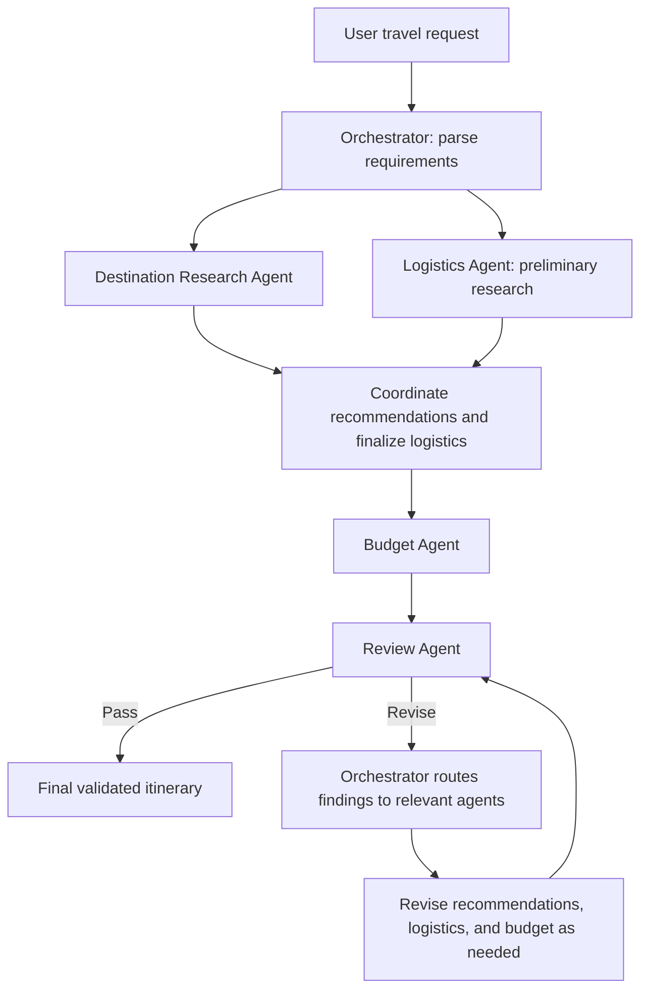

# Problem Statement: Dubai AI Travel Planner

## 1. Background

Planning a trip involves several interconnected decisions: selecting attractions, finding accommodation, organizing transportation, estimating expenses, and matching the itinerary to the traveler's preferences.

A traditional AI chatbot may generate an itinerary in a single response without verifying travel times, checking budget constraints, or validating recommendations against external information. This can result in plans that appear useful but are impractical to follow.

This project explores how specialized AI agents can collaborate on a real-world travel-planning problem. The target prototype uses **LangGraph as its sole multi-agent orchestration framework** to coordinate the agents.

**Framework decision confirmed: 15 November 2026.** No alternative agent-framework
integration or framework-comparison implementation is required. Phases 0–3 provide
the existing foundation; graph execution, model-driven agents and the full planning
UI remain planned in Phases 4–6. See the [implementation plan](implementation%20Plan.md)
and [agent sequence playbook](../playbok.md). This document update implements no
remaining phase.

## 2. Problem Statement

Build a Dubai-focused AI Travel Planning System that converts a natural-language travel request into a personalized, budget-conscious, and practical itinerary.

The system must divide the planning process among specialized agents responsible for orchestration, destination research, logistics, budgeting, and quality review. These agents must share relevant information, coordinate dependent decisions, and revise plans when validation identifies a constraint violation.

The application will demonstrate:

- **LangGraph:** Graph-based orchestration, shared state, parallel execution, conditional routing, and feedback loops.

The project is an educational and technical demonstration of coordinated multi-agent decision-making. Commercial travel booking is outside its scope.

## 3. Objectives

1. Translate natural-language travel preferences and constraints into structured planning requirements.
2. Generate personalized Dubai itineraries for trips lasting 1–7 days.
3. Combine destination recommendations, accommodation areas, transportation, and estimated expenses into a coherent plan.
4. Validate schedules, budgets, and preference alignment, and request revisions when necessary.
5. Use a curated local dataset with optional external integrations to support reliable demonstrations.
6. Make agent execution, outputs, and review-driven changes visible to the user.
7. Demonstrate LangGraph shared state, parallel execution, conditional routing, and review-driven revisions using a structured itinerary format.

## 4. Example User Request and Expected Response

> Plan a 4-day trip to Dubai with a budget of AED 5,000, excluding flights. I enjoy cultural attractions, local food, and beaches. I prefer affordable hotels and want to avoid crowded places.

The system should produce:

- A personalized day-by-day itinerary with suggested timings.
- Recommended attractions, restaurants, and accommodation areas.
- Transportation options and estimated travel durations.
- A category-wise budget breakdown in AED.
- Alternatives when the proposed itinerary exceeds the budget.
- A final itinerary reviewed against the user's preferences and constraints.

Planning assumptions and unavailable information should be explicit. Estimates, including costs and crowd-related recommendations, should not be presented as guaranteed live conditions.

## 5. Multi-Agent System Design

| Agent | Responsibilities | Expected contribution |
| --- | --- | --- |
| **Orchestrator Agent** | Understand the request, extract constraints, coordinate specialists, manage dependencies, and assemble the final itinerary. | Structured requirements, coordinated execution, and consolidated results. |
| **Destination Research Agent** | Research Dubai attractions, restaurants, cultural experiences, and neighborhoods based on interests, location, and preferences. | Relevant destination and activity recommendations. |
| **Logistics Agent** | Suggest accommodation areas, estimate distances and travel times, identify transport options, and sequence activities geographically. | A practical schedule with accommodation areas and transport details. |
| **Budget Agent** | Estimate accommodation, food, transportation, and activity costs; calculate the total; and recommend lower-cost alternatives when required. | An AED budget breakdown and proposed adjustments. |
| **Review Agent** | Check budget compliance, schedule feasibility, preference alignment, duplicate activities, and missing information. Request revisions when needed. | Validation findings and a pass or revision decision. |

## 6. Functional Requirements

### 6.1 Request Interpretation

- Accept natural-language travel requests.
- Extract trip duration, budget, interests, accommodation preferences, and other stated constraints.
- Respect explicit inclusions and exclusions, such as excluding flights from the budget.
- Make missing information and planning assumptions visible.

### 6.2 Itinerary Generation

- Organize activities into a day-by-day schedule with suggested timings.
- Recommend attractions, dining options, and accommodation areas aligned with the request.
- Sequence activities to account for geography and estimated travel times.
- Include transportation options between relevant locations.

### 6.3 Budgeting and Validation

- Estimate accommodation, food, transportation, and activity expenses in AED.
- Calculate the total projected expenditure and compare it with the stated budget.
- Propose alternatives when the plan exceeds the budget.
- Check schedule feasibility, preference alignment, duplicate activities, and missing information.
- Route identified issues back to the relevant agents and review the revised plan before presenting it as validated.

### 6.4 Execution Visibility

- Execute the five-agent planning workflow through LangGraph.
- Display the executing agent and its produced information.
- Show how review findings change the plan.
- Return a structured itinerary with validation findings, assumptions, and source references.

## 7. Dubai Travel Data: Sources and Integration

The system will combine a small curated dataset, reusable open data, and optional no-charge external services. Paid travel-data APIs and billable overages are excluded. Free-service quotas, eligibility, and reuse terms must be checked before integration. The following sources are proposed integrations; their inclusion does not imply that access is already configured.

| Data requirement | Proposed source | Usage |
| --- | --- | --- |
| Attractions and tourism information | Independently authored catalog; licensed no-charge government datasets; official reference links | Research attractions, neighborhoods, and cultural experiences without assuming website content is freely reusable. |
| Restaurants and location details | OpenStreetMap / Overpass and curated records | Discover places, categories, coordinates, and available place details. |
| Routes and transportation | Curated route estimates, optional local open-source routing, and official Dubai RTA information | Estimate distances, journey durations, transit options, and public transport fares. |
| Accommodation | Curated accommodation-area and hotel price-range dataset | Suggest hotel areas and estimate accommodation expenses. |
| Activity and food costs | Published attraction prices and curated AED price ranges | Calculate estimated trip expenditure. |
| Weather, optional | Open-Meteo free service, subject to eligibility and quotas | Recommend weather-appropriate activities for supported travel dates. |

### Data Integration Approach

1. Start with a small curated Dubai dataset stored in JSON or SQLite for reliable demonstrations.
2. Import permitted OpenStreetMap data and optionally use no-charge routing services within verified quotas or a locally hosted routing engine. Keep reviewed local estimates as the default fallback.
3. Use official RTA fare information and curated attraction prices for budgeting.
4. Clearly distinguish verified information, API-derived results, and estimated costs.
5. Fall back to the local dataset when external APIs are unavailable, making the fallback and its limitations visible.

Live hotel bookings, ticket purchases, and guaranteed real-time prices are outside the initial scope.

## 8. LangGraph Multi-Agent Workflow

Implement all five specialist roles as nodes in a LangGraph stateful graph. LangGraph alone coordinates their calls, shared information, parallel research where tasks are independent, explicit joins, conditional routing and the bounded review-feedback loop. Model clients, data tools and deterministic Python services support these nodes; they do not introduce a second agent orchestration framework.

Research into candidate destinations and preliminary logistics can proceed in parallel. Final activity sequencing and route estimates must use the selected locations before budget and review steps complete.

All five agents share typed planning state and approved data tools. Conditional routing sends failed checks back for bounded revisions, and the final result includes the outcome of the last review.

## 9. End-to-End Workflow

The review loop must return revisions for another check rather than bypass validation. If available data or conflicting constraints prevent a feasible plan, the result should explain the unresolved issues rather than claim that the itinerary passed review.

Throughout execution, the interface should display agent activity, useful intermediate outputs, and the changes made in response to review findings.

## 10. Technology Stack

| Component | Technology |
| --- | --- |
| Development environment | Cursor |
| Programming language | Python |
| Multi-agent orchestration framework | LangGraph only |
| Language model | Configurable LLM provider |
| Frontend | Streamlit |
| Local data storage | JSON or SQLite |
| External data | Open data and optional no-charge location, routing, and weather services |
| Validation | Pydantic schemas and rule-based budget and itinerary checks |

## 11. MVP Scope

### In Scope

- Dubai travel planning for short trips of 1–7 days.
- Natural-language requests and personalized recommendations.
- Five specialized agents collaborating on a complete itinerary.
- Day-by-day scheduling, accommodation-area recommendations, and transport estimates.
- Estimated budgets in AED and alternatives for budget violations.
- Review-driven itinerary revision.
- A LangGraph workflow with shared state, parallel research, and conditional review routing.
- Streamlit visualization of agent execution and results.
- A curated local dataset and fallback behavior for unavailable external APIs.

### Optional Integrations

- Permitted OpenStreetMap imports and no-charge open-data downloads.
- Local open-source routing or eligible free routing services with strict quota limits.
- Weather-aware recommendations through the eligible Open-Meteo free service for supported dates.

### Out of Scope

- Destinations outside Dubai in the initial release.
- Live hotel reservations, activity bookings, and ticket purchases.
- Guaranteed real-time pricing or availability.
- A commercial travel-booking platform.
- Paid travel-data APIs, subscriptions, or automatic upgrades to billable tiers.

## 12. MVP Success Criteria

| Criterion | Demonstration of success |
| --- | --- |
| Natural-language planning | A travel request produces a structured Dubai itinerary reflecting the stated duration, budget, interests, and preferences. |
| Meaningful agent collaboration | Outputs from specialized agents contribute to subsequent planning decisions and the final result. |
| Practical schedules and budgets | The itinerary includes travel-time estimates and an AED expense breakdown supported by available data, with estimates identified. |
| Constraint detection and revision | At least one itinerary constraint violation is detected, revised, and reviewed again. |
| Execution transparency | The interface shows agent execution, produced information, and changes resulting from review. |
| LangGraph orchestration | Execution demonstrates shared state, parallel independent tasks, conditional routing, and a bounded revision loop. |
| Local fallback | When external APIs are unavailable, the application uses curated local data and communicates the limitations. |

## 13. Expected Outcome

A working, interactive multi-agent prototype that generates personalized Dubai travel plans and helps technical and nontechnical audiences understand agent specialization, orchestration, collaboration, shared context, and validation through a practical use case.

The no-charge data requirement applies to travel-data acquisition; model inference and hosting are separate resource choices. A local model and local deployment can be used when fully local operation is required.

The final demonstration should show how coordinated agents assemble a plan, identify problems, revise their work, and produce a reviewed itinerary with transparent assumptions and estimated expenses.
