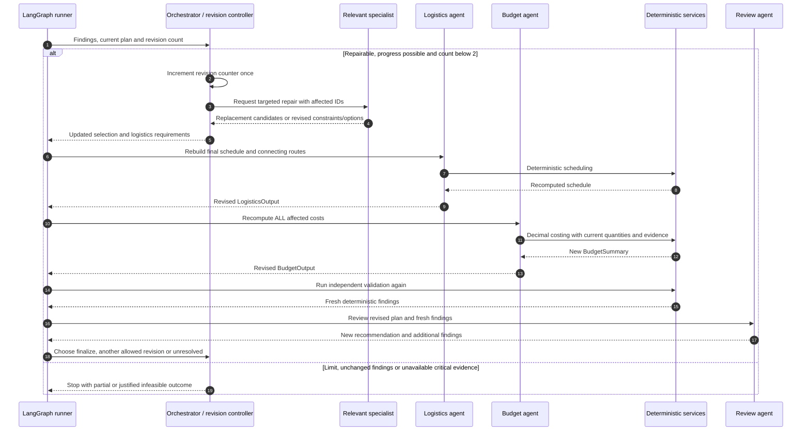
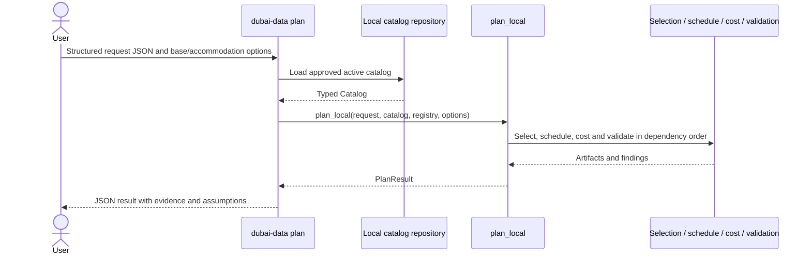
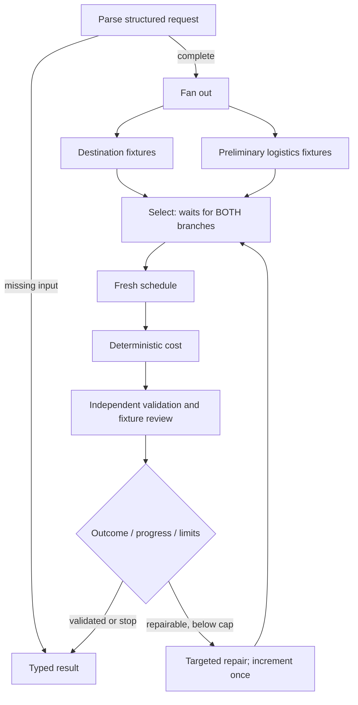

# Multi-agent system playbook

This describes how the Dubai Travel Planner will call its agents and coordinate
parallel work. It follows [the architecture](docs/architecture.md) and
[implementation plan](docs/implementation%20Plan.md).

**Current status:** Phases 0–4 provide domain contracts, local data, deterministic
planning and a working LangGraph fixture workflow. The full sequences below also
describe future Phase 5 model agents and Phase 6 UI integration. The implemented
graph uses deterministic fixture specialists, not model-generated reasoning.

The local workspace now includes **Manage travel data**, **Plan a trip**, and
**Saved itineraries**. These call catalog validation, `plan_local`, and SQLite
snapshot storage directly. They do not invoke parallel agents. Data edits retain
source review dates; saved results are historical snapshots until explicitly rechecked.

```mermaid
sequenceDiagram
    actor User
    participant UI as Local Streamlit workspace
    participant Catalog as CatalogRepository
    participant Planner as plan_local
    participant Plans as PlanRepository
    User->>UI: Review and save data record
    UI->>Catalog: Validate source policy and activate new version
    Catalog-->>UI: Updated local catalog
    User->>UI: Submit trip form
    UI->>Planner: Request and current catalog
    Planner-->>UI: Schedule, budget, findings and evidence
    User->>UI: Save named itinerary
    UI->>Plans: Store compressed snapshot in SQLite
    User->>UI: Reopen saved itinerary
    UI->>Plans: Load snapshot and check read permissions
    Plans-->>UI: Historical result
    User->>UI: Recheck with current data
    UI->>Planner: Saved request and current catalog
    Planner-->>UI: New result; original snapshot preserved
```

**Documentation synchronized:** 15 November 2026. This file and the
[implementation plan](docs/implementation%20Plan.md) reflect the same completed
work. The plan owns phase/checklist status; this playbook explains call order.
The [architecture](docs/architecture.md) owns contracts and design constraints.
These are maintained documentation links, not an automatic synchronization service.

### Completed work and diagram mapping

| Phases | Current state | Relevant playbook content |
| --- | --- | --- |
| 0–1 | Complete: foundation and typed contracts | Existing runner signature and data boundaries |
| 2 | Complete for the bounded four-day example | Local gateway, evidence and example described below |
| 3 | Complete: deterministic services | Section 5, current execution sequence |
| 4 | Complete with fixture specialists | Parallel research branches, join, fresh revision artifacts and bounded termination |
| 5 | Planned; not implemented | Sections 1–3 with actual model-driven specialists |
| 6 | Local UI subset available; phase not complete | Local editor/planner/storage above; agent run management in sections 1 and 4 remains planned |
| 7 | Planned; not implemented | Reliability/release acceptance in the implementation plan |

The 15 November re-verification passed **71 tests**, Ruff lint/format, source-policy
checks, repeatable catalog import and dated/undated catalog-app checks. The active
SQLite catalog matches the curated JSON. See the
[verification report](evaluation/phases-0-3-verification.json). Dataset `2026-11-15.2` has
27 places, 11 accommodation products, 60 prices, 54 routes, 4 tariffs and 34
evidence records. Twenty routes have road-network support; other heuristic routes
remain unsupported. Estimated hours and spending allowances require explicit
acceptance. Re-verification does not refresh source review dates or hotel quotes.

The [saved four-day result](evaluation/phase2-result.json) contains two
`validated_estimate` alternatives at the recorded review time. The refundable
option totals AED 2,940.30–4,153.60 including contingency. Hotel quotes expire;
this is not current inventory or a guaranteed booking price. The original undated
sample remains `partial`. See [scope and assumptions](docs/phase2-example.md).

**User boundary:** The user authorized the local data manager and saved-trip planner.
Phase 4 has also been explicitly authorized and implemented. Remaining Phase 5–7
work requires a separate request. The guardrail role remains
read-only BIOS/firmware and PowerShell-configuration safety oversight.

## 1. Entry point and complete call sequence

The planned UI submits a request to the run service. That service creates a run
context and invokes the graph through the existing runner contract:

```python
run(request, context, emit_event) -> PlanResult
```

`context` carries the run ID, deadline, cancellation signal, configuration hash,
dataset version and prompt version. The Orchestrator interprets and coordinates;
LangGraph schedules the nodes and maintains their shared state.

```mermaid
sequenceDiagram
    autonumber
    actor User
    participant UI as Planning UI
    participant Runs as Run service
    participant Graph as LangGraph runner
    participant O as Orchestrator agent
    participant D as Destination Research agent
    participant L as Logistics agent
    participant B as Budget agent
    participant V as Deterministic services
    participant R as Review agent
    participant Data as Policy-gated local gateway

    User->>UI: Submit Dubai trip preferences and constraints
    UI->>Runs: Start one run
    Runs->>Runs: Snapshot request and create RunContext
    Runs->>Graph: run(request, context, emit_event)
    Graph->>O: Interpret and validate request
    O-->>Graph: Typed request and clarification fields

    alt Essential input missing
        Graph-->>Runs: PlanResult(status=needs_input)
        Runs-->>UI: Show clarification fields
        UI-->>User: Request missing information
    else Request ready
        par Independent destination research
            Graph->>D: Find candidates and alternatives
            D->>Data: Search places, dining and supporting evidence
            Data-->>D: Typed records, sources and freshness
            D-->>Graph: DestinationOutput
        and Independent preliminary logistics
            Graph->>L: Explore accommodation areas and transport assumptions
            L->>Data: Read areas, room options and regional evidence
            Data-->>L: Options and limitations
            L-->>Graph: Preliminary logistics output
        end

        Note over Graph,L: Explicit join waits for BOTH branches
        Graph->>O: Join research and preliminary logistics; select IDs
        O-->>Graph: Selected places, base and accommodation

        Graph->>L: Build final logistics from selected locations
        L->>Data: Fetch applicable hours, routes and accommodation evidence
        Data-->>L: Evidence and unresolved gaps
        L->>V: Construct timed days, routes and meal/rest slots
        V-->>L: Deterministic schedule
        L-->>Graph: Final LogisticsOutput

        Graph->>B: Cost the actual schedule, stay and party
        B->>Data: Fetch scoped prices and fee information
        Data-->>B: Price evidence and eligibility
        B->>V: Calculate quantities, AED bounds and contingency
        V-->>B: BudgetSummary and missing costs
        B-->>Graph: BudgetOutput and alternatives

        Graph->>V: Independently validate schedule, costs and hard constraints
        V-->>Graph: Deterministic findings
        Graph->>R: Review complete plan, evidence and findings
        R-->>Graph: Additional findings and repair recommendation
        Graph->>O: Decide finalization, revision or unresolved outcome
        O-->>Graph: One routing decision

        alt Evaluated hard constraints pass
            Graph-->>Runs: PlanResult(status=validated_estimate)
        else Repairable and revision budget remains
            Note over Graph,R: Execute revision sequence below, then return its outcome
            Graph->>Graph: Revise and recompute downstream stages
            Graph-->>Runs: Reviewed PlanResult
        else Unresolved or demonstrated infeasibility
            Graph-->>Runs: PlanResult(status=partial or infeasible)
        end
        Runs-->>UI: Result, sources, assumptions and findings
        UI-->>User: Show itinerary, AED budget and limitations
    end
```

The gateway reads approved local records through the repository. The current
implementation makes no travel-data network calls. A future optional provider
must pass the same policy and shared quota controls.

## 2. Which agents run in parallel?

There are seven specialist roles, not seven independent workers running at once.
The first fan-out has **two concurrent branches**:

| Stage | Input | Output | Execution dependency |
| --- | --- | --- | --- |
| Orchestrator: interpret | User request and configuration | Typed request, clarifications | First |
| Destination Research | Valid request | Candidates and alternatives | Parallel with preliminary logistics |
| Logistics: preliminary | Valid request and area data | Base/room options and regional assumptions | Parallel with research |
| Planner | Both branch outputs | Selected grounded IDs | Waits for both |
| Scheduler | Selected locations and base | Timed days and connecting routes | After planning |
| Budget | Final schedule, stay, party and prices | Calculated budget and alternatives | After final logistics |
| Review | Complete plan and deterministic findings | Additional findings and recommendation | After costing and validation |

Logistics owns the preliminary accommodation/base output. Planner cannot select until
both parallel branches finish. Scheduler cannot determine visit order before Planner
returns grounded IDs. Budget cannot calculate the final total before those routes and
the stay are available.

The join feeds the `planner` node: it waits for both `destination` and `preliminary`.
Concurrent nodes return separate state updates rather
than overwriting shared scalar fields. Research owns candidates; preliminary
logistics owns its own output; selection has one writer. Evidence and events
merge by stable IDs, rejecting conflicting records.

## 3. Revision calls and downstream recomputation

The initial plan is revision **0**. At most **two revisions** follow it. The
Orchestrator dispatches repairs to the relevant specialist; this does not imply
another unconditional parallel fan-out. Only independent repair tasks could run
concurrently, and their outputs would need a join before reselection.



For example, an over-budget result can lead to a cheaper accommodation choice.
The system must then rebuild routes from that base, recompute transport and hotel
costs, and review the whole result. It must not merely subtract a hotel-price
difference from the previous total.

Budget reasoning never replaces deterministic arithmetic. Review cannot erase
hard validation failures. No agent may relax the user's hard budget, exclusions
or accessibility requirements without changed user input.

## 4. Events, cancellation and failure

During every stage, the runner sends sanitized events through `emit_event` to the
run service. The UI displays progress without starting duplicate runs. Typical
events are `agent_started`, `provider_result`, `artifact_ready`,
`validation_finding`, `revision_started` and `run_completed`.

Cancellation and deadline checks occur before tasks, tools and revisions. On
cancellation, the run service must prevent late results becoming the active
result. A recoverable evidence gap can produce `partial`; an execution failure
with no usable result produces `failed`. `infeasible` requires a demonstrated
conflict, not merely a failed first selection. These controls belong to the
fixture runner. UI run ownership, event display and cancellation controls remain Phase 6.

## 5. What can be called today?

Both current paths are deterministic and do not spawn model-driven agents.
The original direct-service path remains available:



The completed Phase 2 example is documented in
[phase2-example.md](docs/phase2-example.md). Phase 4 now provides graph execution with
fixtures; Phase 5 will supply real model-driven specialist implementations; Phase 6
connects the planning UI and run management.

Call the graph with `dubai-data fixture-plan evaluation/phase2-request.json --base
area-dubai-marina --accommodation rove-marina-quote-flex`. For historical verification,
run `python scripts/verify_phase4.py`. Current-clock calls preserve quote expiry.



Only initial research fans out. Repairs reuse approved research, refilter selection
where needed, or evaluate accommodation alternatives, then rebuild logistics,
budget and review. The retry reducers reject conflicting evidence IDs and preserve
events from distinct revisions. Deadline/cancellation checks are cooperative; no
model/provider timeout behavior is claimed. There are 24 graph tests and 99 total
passing tests; see [verification](evaluation/phase4-verification.json).

## 6. Guardrail boundary for this development chat

The user-requested guardrail agent is **read-only safety oversight**, separate
from the application's five travel-planning roles. It does not create project
files, participate in itinerary research or calculate budgets. Its remit is to
audit for BIOS/firmware and PowerShell-configuration changes. Project work must
leave BIOS, firmware, PowerShell profiles, execution policy and persistent system
settings untouched. An audit can flag risks; it is not an operating-system-level
block on commands.
